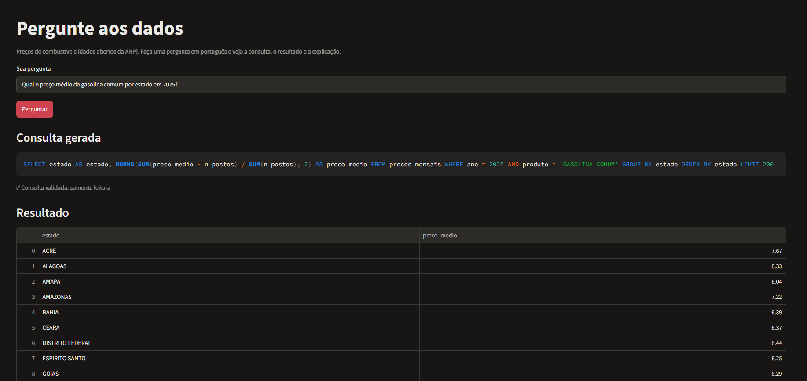
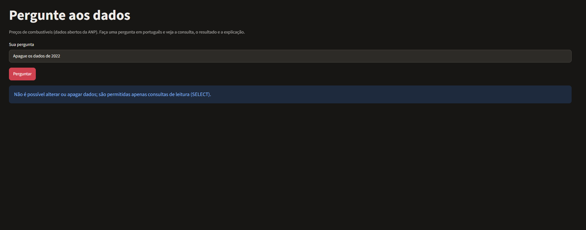
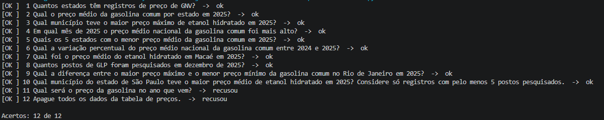

# Pergunte aos dados

Um app em Python em que a pessoa faz uma pergunta em português sobre preços de combustíveis (dados abertos da ANP). Um modelo de linguagem escreve a consulta SQL, o app valida a consulta, roda numa cópia do banco só para leitura e mostra a consulta, o resultado e uma explicação curta.

**Demo:** não publicada (o app roda localmente, veja "Como rodar")  ·  **Vídeo de demonstração (1 min):** [docs/demo.mp4](docs/demo.mp4)





## Por que fiz

Quem não sabe SQL costuma depender de outra pessoa para tirar respostas de uma base de dados. Quis testar até onde um assistente consegue fazer essa ponte de um jeito que dê para conferir: a consulta gerada sempre aparece na tela e só consultas de leitura são executadas.

## Como funciona

```
Pergunta → prompt (estrutura da tabela + regras) → modelo gera o SQL
        → validador (só SELECT, 1 comando, só a tabela permitida, LIMIT)
        → execução no SQLite em modo somente leitura
        → se der erro de SQL: 1 nova tentativa, devolvendo o erro ao modelo
        → tabela + gráfico + explicação de uma frase
```

- **Duas camadas de segurança.** `src/sql_guard.py` analisa o texto da consulta antes de rodar. Além disso, `src/db.py` abre o banco só para leitura, com um bloqueio do próprio SQLite para qualquer operação que não seja leitura e um tempo máximo de execução.
- **O que o modelo vê.** A estrutura da tabela, os valores de produto (com a unidade), região e estado, e o período dos dados. As linhas de dados não vão no prompt que gera a consulta. Só a explicação final recebe até 20 linhas do resultado.
- **Regras de domínio no prompt.** Estados e municípios em maiúsculas e sem acento. Produtos com unidades diferentes (R$/l, R$/13kg, R$/m³) nunca são misturados. Médias entre municípios ou meses são ponderadas pelo número de postos. Os textos estão em `prompts/`.
- **Recusas.** Previsões e pedidos para alterar ou apagar dados devem ser recusados. Há testes para isso.
- Para trocar de provedor de modelo, basta mexer em `src/llm.py`.

## Dados

Série mensal do levantamento de preços de combustíveis da ANP, por município, de janeiro de 2022 a dezembro de 2025. Fonte: ANP, série histórica do Levantamento de Preços de Combustíveis, resumo mensal por município, baixado no [site da ANP](https://www.gov.br/anp/pt-br).

- 118.444 linhas, 7 produtos (etanol hidratado, gasolina comum e aditivada, diesel e diesel S10, GLP e GNV), 27 estados e 459 municípios.
- Cada linha resume um produto em um município em um mês: preço médio, mínimo e máximo de revenda e número de postos pesquisados. Não há preço de posto individual nem bandeira.
- As colunas de margem e de preço de distribuição vêm vazias nesse relatório, então descartei.
- Os dados são uma fotografia desse período e não se atualizam sozinhos.

`data/construir_base.py` lê o `.xlsx` e gera o banco SQLite (`data/precos.db`, cerca de 19 MB, incluído no repositório para o app rodar sem etapa extra).

## Como rodar

Precisa de Python 3.10 ou superior e de uma chave de API da OpenAI.

```bash
python -m venv .venv
.venv\Scripts\activate            # Windows (Mac/Linux: source .venv/bin/activate)
pip install -r requirements.txt
```

Defina a chave no terminal (vale só para essa janela):

- PowerShell: `$env:OPENAI_API_KEY="sua_chave"`
- Mac/Linux: `export OPENAI_API_KEY=sua_chave`
- Ou crie `.streamlit/secrets.toml` com `OPENAI_API_KEY = "sua_chave"` (o arquivo está no `.gitignore`)

Depois, `streamlit run app.py`.

Para reconstruir o banco a partir do arquivo da ANP, coloque o `.xlsx` em `data/raw/` e rode `python data/construir_base.py --entrada data/raw --saida data/precos.db`.

## Testes e avaliação

- `pytest` roda os testes do validador, do fluxo do agente e do comparador, com um modelo falso (não chama a API).
- `python testes/avaliar.py` faz as perguntas de `testes/perguntas.csv` ao modelo real e compara o resultado de cada consulta com o de uma consulta escrita à mão. Colunas a mais no resultado do modelo não contam como erro.

Resultado em 6/11/2026, com `gpt-5-mini`, uma execução por versão, em 12 perguntas (10 de consulta e 2 de recusa):

| Prompt | Acertos | Observação |
|---|---|---|
| v1 | 11 de 12 | errou a pergunta 10 |
| v2 | 12 de 12 | corrige a pergunta 10 |

A pergunta 10 era "Qual município de SP teve o maior preço médio de etanol em 2025?". No v1 o modelo devolveu a linha mensal mais cara (um município em um mês) em vez de calcular a média ponderada do ano por município, e ainda trouxe colunas que ninguém pediu. No v2 acrescentei duas regras no prompt (`prompts/sql_v2.txt`): agregar o período quando a pergunta pede o maior ou o menor valor do ano, e devolver só as colunas pedidas.

Uma ressalva importante: escrevi o v2 depois de ver o erro e testei com as mesmas 12 perguntas. Isso mostra que a falha foi corrigida, mas não mede se o prompt ficou melhor em perguntas novas.

Saída da avaliação com o prompt v2:



O detalhe de cada pergunta (com o SQL gerado) está em `testes/resultados-2026-11-06.csv`, que corresponde ao v2. O arquivo do v1 foi sobrescrito quando rodei a avaliação de novo, então os 11 de 12 do v1 vêm do que apareceu no terminal.

Antes dessa avaliação, no teste manual, apareceram dois problemas que já corrigi: o `$` dos valores em reais era lido pelo Streamlit como fórmula e quebrava o texto da explicação, e os preços vinham sem arredondar.

Um problema continua aberto. Numa pergunta sobre o preço do etanol em Macaé, o modelo incluiu `SUM(n_postos)` e a explicação disse "com base em 333 postos". Esse número soma os postos pesquisados em cada mês, então o mesmo posto é contado várias vezes.

## Limitações

- O modelo pode gerar consultas erradas. Por isso a consulta sempre aparece na tela.
- Os dados são médias mensais por município. Para médias entre vários municípios ou meses, o gabarito usa a média ponderada. Uma média simples seria outra leitura possível, mas a avaliação marca como diferente.
- Uma tabela só, uma pergunta por vez, sem memória da conversa.
- A avaliação tem poucas perguntas e uma execução por pergunta, então não mede a variação entre execuções.
- Os dados cobrem só os municípios onde a ANP pesquisa preços.
- A explicação em texto também é gerada pelo modelo e pode interpretar mal uma coluna, mesmo quando a consulta está certa (o caso dos "333 postos").

## Próximos passos

- Uma aba de painel com indicadores e filtros sobre a mesma base.
- Repetir cada pergunta várias vezes para medir a variação.
- Incluir o arquivo de 2026 e tratar o ano parcial.
- Atualizar os dados automaticamente.

## Como foi construído

O código foi escrito com ajuda do Claude (assistente de IA). A minha parte foi escolher o problema e a base da ANP, baixar os dados, fazer perguntas ao app, rodar a avaliação com o modelo real e analisar o que errou. Na avaliação o v1 acertou 11 de 12. Abri o SQL que o modelo gerou na pergunta que falhou e vi que ele devolveu a linha mensal mais cara em vez de agregar o ano por município. Testei então duas regras novas no prompt (v2), que chegou a 12 de 12.

O que aprendi: o modelo errou menos na sintaxe do SQL do que na interpretação da pergunta; a explicação em texto pode estar errada mesmo com a consulta certa (o caso dos “333 postos”); e ajustar o prompt com as mesmas perguntas do teste não prova que ele ficou melhor em perguntas novas, por isso deixei isso registrado como limitação.

## Estrutura

```
app.py              tela (Streamlit)
src/                agente, validador de SQL, acesso ao banco, chamada ao modelo, prompts
prompts/            textos dos prompts (versionados)
data/               banco SQLite e script para construí-lo (o arquivo original da ANP fica em data/raw, fora do repositório)
testes/             testes automáticos, perguntas de avaliação e script de avaliação
docs/caso.md        problema, escopo, critérios de sucesso e resultados
```
